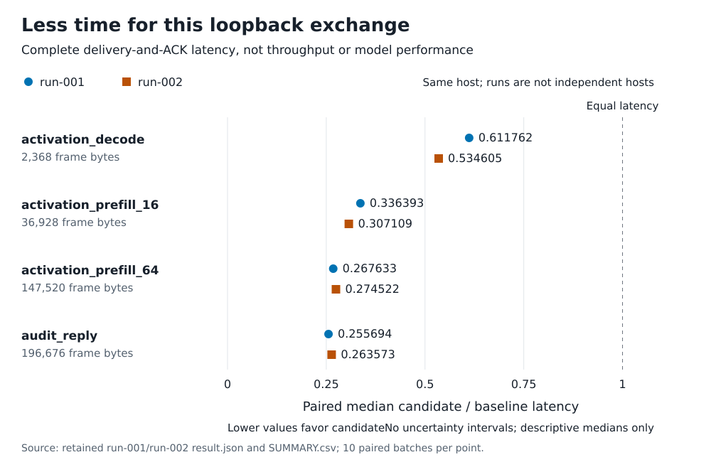

# Measured results: start here

**The result:** a narrowly changed frame-validation routine reduced complete delivery-and-acknowledgement latency in all four fixed synthetic payload cases in each of two retained runs. The paired median candidate/baseline ratios were **0.256–0.612**. This is evidence about a two-process loopback exchange on one host, **not faster household inference, mesh throughput or a benefit on real devices**.

This page explains the accepted [loopback framing study](studies/loopback-framing-comparison/README.md), published at [commit 10bc842](https://github.com/EastonSell/household-compute/commit/10bc842d4a38fc3069d5047828cda123ddb67a92). It adds no experiment and changes no historical source or result file.

## Read the eight measured outcomes



Below 1 means the candidate took less time. For example, 0.611762 means that the median paired ratio was about 61.2% of baseline latency, or 38.8% lower. It does not mean 61.2% more throughput. Each mark summarizes ten paired batches, not ten devices, and there are no confidence intervals in this figure.

| Synthetic payload case | Complete frame bytes | run-001 ratio | run-002 ratio |
| --- | ---: | ---: | ---: |
| activation_decode | 2,368 | 0.611762 | 0.534605 |
| activation_prefill_16 | 36,928 | 0.336393 | 0.307109 |
| activation_prefill_64 | 147,520 | 0.267633 | 0.274522 |
| audit_reply | 196,676 | 0.255694 | 0.263573 |

These are descriptive summaries of these retained runs, not a population estimate or independent hardware replications. Frame bytes include the frame header; they are application bytes, not network-wire traffic. All eight outcomes are shown, including the smaller reduction for the smallest frame. The reason for that pattern was not isolated.

## What changed, and what was timed?

The candidate changes only the check that FP32 tensor values are finite. On the native little-endian path selected in both runs, it uses a float memory view and `map(math.isfinite, ...)` instead of the original tuple-producing scan and Python generator. Other framing behavior stays unchanged. Both the sender and receiver use the selected variant, so this is a **two-ended treatment**, not a separate measurement of sender or receiver savings. The code was studied as an isolated candidate, not installed as a production replacement. See the [exact candidate diff](studies/loopback-framing-comparison/reproduction/studies/finite-validation-optimization/CANDIDATE_DIFF.patch) and [earlier in-memory results](studies/loopback-framing-comparison/reproduction/studies/finite-validation-optimization/RESULTS.md).

One exchange runs from the driver starting its timed loop through validation and packing, kernel loopback delivery, receiver decoding and exact-frame equality, a fixed acknowledgement (ACK) sent back, and driver ACK validation and completion bookkeeping. Adapter deadline checks, cross-process scheduling and Python loop overhead are included. Process/connection/fixture setup, warmups, control messages, journal writes and cleanup are excluded. This is **not a transport-only timing**. Read the [exact boundary and controls](studies/loopback-framing-comparison/reproduction/studies/loopback-framing-comparison/PROTOCOL.md#exact-timed-boundary).

## Exactly what is the denominator?

For one run and one case:

1. Ten blocks each contain an adjacent baseline batch and candidate batch. Five pairs are baseline-first; five are candidate-first.
2. Each batch times ten sequential complete delivery-and-ACK exchanges. Divide the recorded batch duration by ten to obtain its mean latency per exchange.
3. Within each block, divide the candidate batch mean by its paired baseline batch mean.
4. The plotted point is the median of those ten ratios. It is **not** the candidate's overall median divided by the baseline's overall median, and the two runs are not pooled.

Across all four cases and both runs, that is **160 measured batch rows, 80 pairs and 1,600 measured exchanges**. The 32 warmup exchanges and eight-exchange untimed capability canary are separate and excluded. All prespecified rows were retained; there were no replacement runs or discarded outliers. The [full report](studies/loopback-framing-comparison/RESULTS.md) also gives absolute latency medians, paired differences, correctness and cleanup evidence.

## What remains untested?

- **Real workloads and devices:** these are fixed finite synthetic values, not measured model activations. There is no household-device or cross-host network measurement.
- **A working distributed system:** one host, two Python processes, one persistent TCP loopback connection and one frame in flight do not test a mesh, concurrent throughput, bandwidth scaling or end-to-end inference.
- **Broader benefits:** model quality, energy, RSS and cumulative allocation are not established by this timing result. Neither is deployment readiness or security.
- **Generalization and cause:** two runs on the same host do not establish population effects. Balanced order does not eliminate scheduling, caching, CPU-frequency or load effects. The contributions of sending and receiving, and the explanation for the smallest-frame pattern, remain unresolved.

The supported next claim is deliberately narrow: the earlier in-memory reduction also appeared in this particular complete loopback exchange. Broader claims need separately designed and reviewed measurements, not extrapolation from this figure.

## Check the numbers and reproduce the figure

Python's standard library is sufficient. From the repository root, these commands only read retained evidence or run synthetic tests; they open no sockets and collect no timing observations:

```sh
python -B studies/loopback-framing-comparison/verify_publication.py
python -B tools/plot_loopback_results.py --check
python -B -m unittest discover -s tests -p 'test_plot_loopback_results.py' -v
python -B -O -m unittest discover -s tests -p 'test_plot_loopback_results.py' -v
```

The first command checks the study's complete public artifact inventory and provenance. The figure checker independently rebuilds all 128 summary statistics from the 160 raw rows, compares them with both result JSON summaries and the full-precision CSV, checks this page's eight rounded values, and requires the committed SVG to match deterministic regeneration. It prints the source and figure SHA-256 hashes. The figure checker supplements, rather than replaces, the full study verifier.

To write a fresh copy of the same figure without running the experiment:

```sh
python -B tools/plot_loopback_results.py --output /tmp/loopback-framing-ratios.svg
```

Primary sources: [full-precision SUMMARY.csv](studies/loopback-framing-comparison/reproduction/studies/loopback-framing-comparison/SUMMARY.csv), [run-001 raw rows](studies/loopback-framing-comparison/reproduction/studies/loopback-framing-comparison/run-001/result.json), [run-002 raw rows](studies/loopback-framing-comparison/reproduction/studies/loopback-framing-comparison/run-002/result.json), and [protocol](studies/loopback-framing-comparison/reproduction/studies/loopback-framing-comparison/PROTOCOL.md). For new empirical reproduction, follow the study's [reproduction limits](studies/loopback-framing-comparison/README.md#reproduction-limits): preserve this evidence and obtain a new source freeze and admission rather than rerunning into historical result paths.
